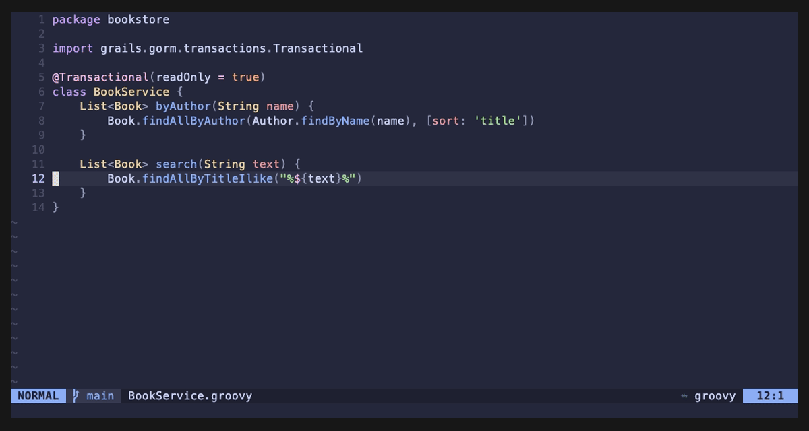

# grails-language-server

[](https://github.com/vdassios/grails-language-server/actions/workflows/ci.yml)
[](https://github.com/vdassios/grails-language-server/releases)
[](LICENSE)

grails-language-server is a [language server](https://microsoft.github.io/language-server-protocol/) for Groovy and Grails. It compiles your code with your project's own Groovy and Grails, so it knows the methods and properties that Grails adds at compile time: `render` and `params` in controllers, `save` and `get` on domain classes, dynamic finders, and more. Completion, hover, and go to definition all work with them, in any editor that supports the Language Server Protocol.



The recording shows Neovim on [`demo/bookstore`](demo/), a small Grails 7 app that you can try the server on.

## Features

- **Your project's Groovy and Grails.** The server compiles each source set in its own class loader, with your project's jars, on your project's JDK. Your code is compiled by the same Groovy version (2.5 to 6) and the same AST transformations as in your build. This is the main difference from [groovy-language-server](https://github.com/GroovyLanguageServer/groovy-language-server), which this server is forked from: it compiles every project with the Groovy 4 that it bundles. Grails 4 to 8 are supported. ([How it works](docs/how-it-works.md), [tested versions](#status), [JDK table](docs/editors.md#install))
- **Standard language features.** Diagnostics, completion, hover, signature help, go to definition, and document and workspace symbols. ([Feature status](docs/conformance.md))
- **Any LSP editor.** Setups are tested in Neovim, Helix, Emacs, and VS Code. For Neovim, [grails.nvim](https://github.com/vdassios/grails.nvim) also adds a tree-sitter grammar for GSP. ([Editor setup](docs/editors.md), [GSP grammar](https://github.com/vdassios/grails.nvim/blob/main/docs/grammar.md))
- **Grails artefacts.** Controllers, domain classes, services, and taglibs have the members that Grails adds to them. A property such as `def bookService` is typed as `BookService`. ([More](docs/features.md#grails-artefacts))
- **GORM.** No class declares a dynamic finder such as `findByTitleLikeAndAuthor`. GORM builds it from the method name at run time. The server reads the name the same way GORM does. It completes a finder one part at a time, gives it a type, describes the query on hover, and warns you when GORM would reject it. It also understands criteria blocks, `where` blocks, `constraints`, and `mapping`. ([More](docs/features.md#gorm))
- **Grails conventions.** Strings that name a view, template, layout, controller, or action complete, take you to their target, and get a hint when the target doesn't exist. ([More](docs/features.md#conventions))
- **GSP pages.** Tags and attributes come from your taglibs and your jars. Code in a page is translated by Grails's own `GroovyPageParser`, loaded from your class path, and then compiled. You get errors, completion, hover, and go to definition inside `${ }`. Model variables are typed from the controllers that render the page. ([More](docs/features.md#gsp-pages))
- **Library sources.** Go to definition and hover work on classes from jars and the JDK. If a sources jar is missing, the server can download it when your editor asks. ([More](docs/features.md#library-sources))
- **Tested on public projects.** The server was measured on five open-source Grails apps and plugins, from Grails 4 to 8 and up to 1,787 Groovy files. It found the Grails members on every artefact. Three of the projects compile with no errors, and every error in the other two has a known cause. ([Results](benchmarks/results.md))

## Quick start

1. Download `grails-language-server-all.jar` from the [releases](https://github.com/vdassios/grails-language-server/releases) page.
2. Find the JDK that your project's Gradle build uses, and run the server on it. For a Grails 4 project (Groovy 2.5), that has to be JDK 15 or older. See the [JDK table](docs/editors.md#install).
3. Set up your editor to start the server, with the Gradle root as the workspace root. For Neovim 0.11 or later, add this to your config:

   ```lua
   vim.lsp.config("grails_ls", {
     cmd = { "java", "-jar", "/path/to/grails-language-server-all.jar" },
     filetypes = { "groovy", "gsp" },
     root_markers = { "settings.gradle", "settings.gradle.kts", "gradlew" },
     init_options = { trusted = true },
   })
   vim.lsp.enable("grails_ls")
   ```

4. Open a controller and hover over `render`. The first start runs your Gradle build, so it can take a while.

`trusted = true` allows the server to run your project's Gradle build and AST transformations. Only set it for projects you trust. See [Trust](docs/how-it-works.md#trust).

If you use Neovim, [grails.nvim](https://github.com/vdassios/grails.nvim) does all of this for you. It downloads the jar, finds the right JDK, and adds the GSP grammar. For Helix, Emacs, VS Code, and Zed, see [Editor setup](docs/editors.md).

## Status

The server is in pre-alpha. It runs on Linux and macOS. It has not been tested on Windows.

This is what is tested:

- **Groovy:** the `analysis` tests pass on Groovy 2.5.23, 3.0.23, 4.0.33, 5.1.3, and 6.0.0.
- **Grails 4 and 7:** the server's tests run on two fixture projects: Grails 4.1.4 (Groovy 2.5, JDK 11) and Grails 7.2.4 (Groovy 4, JDK 17).
- **Grails 8:** a unit test reads the taglib class files of Grails 8, which declares tags as methods. There is no Grails 8 fixture project.
- **Grails 5 and 6:** each was measured once, by hand, on a public project. See [benchmarks/results.md](benchmarks/results.md), which also covers a Grails 4, 7, and 8 project.

For the status of each feature, see [Feature status](docs/conformance.md).

## Documentation

- [Features](docs/features.md): what the server understands about Grails artefacts, GORM, conventions, GSP pages, and library sources.
- [Install and editor setup](docs/editors.md): which JDK to use, and setup for Neovim, Helix, Emacs, VS Code, and Zed.
- [How it works](docs/how-it-works.md): the design, trust, protocol extensions, and known limits.
- [Feature status](docs/conformance.md): which features are supported, planned, or out of scope.
- [Roadmap](docs/roadmap.md): the work that is left, and the routes the server could take later.
- [Benchmarks](benchmarks/results.md): measurements on a [public corpus](benchmarks/corpus.md) of Grails projects.
- [Development](docs/development.md): building, testing, and releasing.

## Origin

This project is a fork of [groovy-language-server](https://github.com/GroovyLanguageServer/groovy-language-server) by Prominic.NET, Inc. Its providers and AST visitor were the starting point for the `analysis` module. See `NOTICE`.

## License

[Apache License 2.0](LICENSE).

## Roadmap

Four language features come next: find all references, rename, type definition, and document highlight. A VS Code extension, published on the Marketplace and Open VSX, is planned too. For the gaps in Grails support and the routes the server could take later, see the [Roadmap](docs/roadmap.md).
